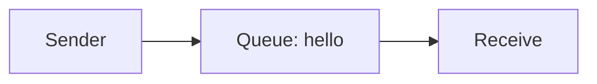
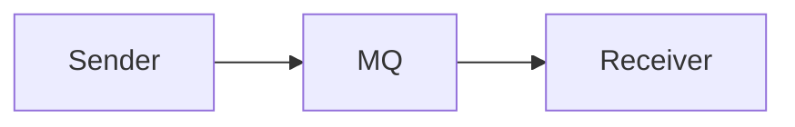

# Hello World com RabbitMQ em .NET

Este projeto demonstra um fluxo simples de mensageria usando RabbitMQ em duas aplicações .NET:

- `Sender`: envia uma mensagem para uma fila RabbitMQ;
- `Receive`: escuta a fila e processa as mensagens recebidas.

## Visão geral

O cenário implementado é o clássico exemplo "Hello World" do RabbitMQ:



A aplicação `Sender` cria a fila `hello` e publica uma mensagem com o texto `Hello World!`. A aplicação `Receive` se conecta à mesma fila e imprime cada mensagem recebida.

## Estrutura do projeto

```text
HelloWord/
├── Sender/
│   ├── Program.cs
│   └── Sender.csproj
├── Receive/
│   ├── Program.cs
│   └── Receive.csproj
├── Sender.sln
├── readme.md
└── .gitignore (se existir)
```

## Tecnologias utilizadas

- .NET 10
- RabbitMQ
- Biblioteca `RabbitMQ.AMQP.Client` v1.4.1

## Pré-requisitos

Antes de executar o projeto, você precisa ter instalado:

- SDK do .NET 10 ou superior
- RabbitMQ em execução localmente
- Opcional: Docker para rodar o broker em um container

## Configuração do RabbitMQ

### Opção 1: usando Docker

```bash
docker run -d --hostname rabbitmq --name rabbitmq -p 5672:5672 -p 15672:15672 rabbitmq:3-management
```

Depois, o RabbitMQ estará disponível em:

- AMQP: `amqp://localhost:5672`
- Management UI: `http://localhost:15672`
- Usuário padrão: `guest` / `guest`

### Opção 2: instalação local

Instale o RabbitMQ no ambiente e inicie o serviço. O endereço esperado pelo código é o padrão do broker local.

## Configuração da conexão

Os projetos `Sender` e `Receive` definem a variável `brokerUri` no arquivo `Program.cs` e usam a URI do broker. O valor esperado é algo semelhante a:

```csharp
const string brokerUri = "amqp://localhost:5672/%2f";
```

Se o RabbitMQ estiver em outra máquina, porta ou virtual host, ajuste essa string antes de executar os projetos.

## Executando o projeto

Na raiz do repositório, execute os comandos abaixo em terminais separados:

### 1. Iniciar o consumidor

```bash
dotnet run --project Receive
```

Esse processo ficará aguardando mensagens na fila `hello`.

### 2. Enviar uma mensagem

Em outro terminal:

```bash
dotnet run --project Sender
```

A saída esperada do `Sender` será similar a:

```text
[x] Sent Hello World!
```

A saída do `Receive` será similar a:

```text
Received a message: Hello World!
```

## Fluxo de funcionamento

1. O `Sender` cria a fila `hello` usando a API de gerenciamento do broker.
2. O produtor publica a mensagem `Hello World!`.
3. O `Receive` se conecta ao mesmo broker e escuta a fila.
4. Quando a mensagem chega, o consumidor a aceita e a exibe no console.

## Observações importantes

- A fila criada no exemplo é do tipo `QUORUM`.
- A fila e a mensagem são simples e servem como base para um projeto real de mensageria.
- Este exemplo é de referência para aprender o fluxo de publish/subscribe com RabbitMQ em .NET.

## Solução de problemas comuns

### Erro ao conectar ao RabbitMQ

Verifique se:

- o serviço do RabbitMQ está ativo;
- a porta `5672` está liberada;
- a URI no `Program.cs` está correta;
- o usuário e a senha estão válidos (padrão: `guest`/`guest`).

### Mensagem não é recebida

Verifique se:

- o `Receive` foi iniciado antes do `Sender` ou pelo menos antes da mensagem ser enviada;
- a fila `hello` foi criada corretamente;
- o broker não está usando um virtual host diferente do `/`.


## Referências

- RabbitMQ: https://www.rabbitmq.com/
- RabbitMQ AMQP Client for .NET: https://www.nuget.org/packages/RabbitMQ.AMQP.Client/
- Documentação oficial de filas e exchanges do RabbitMQ: https://www.rabbitmq.com/documentation.html

=======

